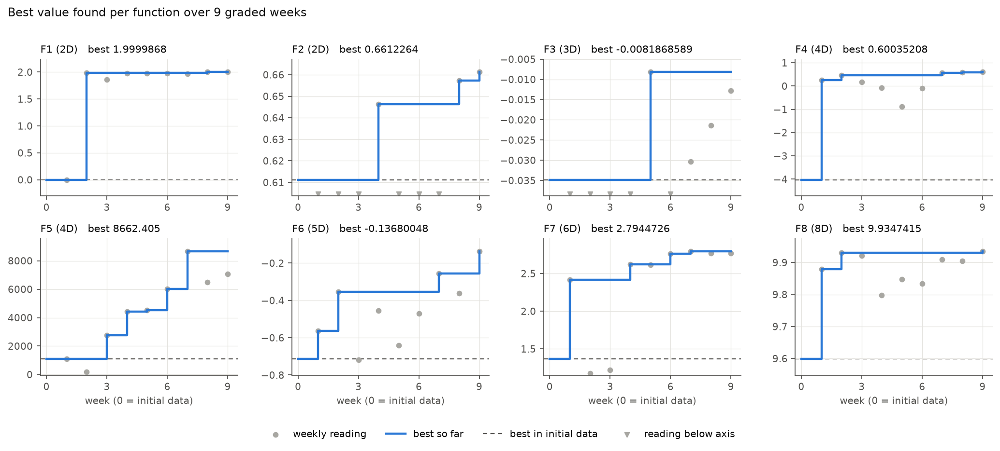

# BBO Capstone: Black-Box Optimisation of Eight Hidden Functions

This project runs sequential Bayesian optimisation on eight black-box
functions, ranging from 2D to 8D.

- **Budget:** one query per function per week, submitted through the course
  portal. Results come back seven days later.
- **Objective:** every function is maximised over the unit hypercube.
- **Query format:** hyphen-separated strings with six decimals per
  coordinate. The usable domain is `[0.000001, 0.999999]` on each axis.

**Status at this snapshot:** 9 rounds have been graded. The week-10 queries
are submitted and their results are pending (see
[`reports/README.md`](reports/README.md#week-10-pending)).



## Non-technical explanation

Picture eight sealed machines. Each has a few dials and one output gauge.
You can't open them, and each week you can set the dials and read the gauge
only once per machine. The goal is to find the dial settings that give each
machine its highest reading.

For every machine, the project builds a statistical *imitation* from all the
readings so far. The imitation gives a best guess for any dial setting and
says how unsure it is. Each week, the next setting is chosen where the
imitation sees the best chance of beating the current record.

Every query goes in with a written prediction, and the prediction is graded
when the result comes back. Wrong predictions count as information: they show
when the imitation is too smooth or too confident. When that happens, the
strategy for that machine changes by a fixed rule rather than by feel.

After nine weeks, every machine has beaten the best reading in the starting
data. Machine F1 started at effectively zero and is now within 0.00002 of
what looks like its true peak, 2.0.

## Data

| Fn | Dim | Description hint | Supplied points | Queried (graded) | Total |
|----|-----|------------------|---------------:|-----------------:|------:|
| 1 | 2 | point "sources", near-zero field | 10 | 9 | 19 |
| 2 | 2 | noisy log-likelihood | 10 | 9 | 19 |
| 3 | 3 | drug side-effects (outputs <= 0) | 15 | 9 | 24 |
| 4 | 4 | multi-modal, sharp peak | 30 | 9 | 39 |
| 5 | 4 | chemical yield (log-scale) | 20 | 9 | 29 |
| 6 | 5 | recipe score (outputs <= 0) | 20 | 9 | 29 |
| 7 | 6 | hyperparameter surface | 30 | 9 | 39 |
| 8 | 8 | near-linear, plateau | 40 | 9 | 49 |

- **Supplied designs.** These are kept **unmodified** as
  `data/function_N/initial_inputs.npy` and `initial_outputs.npy`.
- **Graded queries.** Each one is a row of `data/function_N/observations.csv`
  (`x1..xd,y`). The file is append-only, so supplied points and queried
  points can always be told apart.
- **Submission log.** `results/query_log.csv` holds all 80 submissions: week,
  function, portal string, observed value, and a new-best flag. The week-10
  observed values are blank.

Provenance and composition are documented in
[`datasheets/`](datasheets/README.md).

## Method

The same framework runs every function, with a different regime per function.
The regimes are stored as data in [`src/bbo/config.py`](src/bbo/config.py).

1. **Surrogate: Gaussian process.** A Matérn 5/2 kernel with ARD lengthscales,
   refit every week by maximum likelihood with `normalize_y`. Per-function
   options are:
   - a WhiteKernel for the noisy function (F2);
   - a `log(y)` transform where outputs span orders of magnitude (F5) and
     `log|y|` for F1's near-zero field;
   - lengthscale caps where ARD's "this input is irrelevant" verdicts proved
     unreliable.

   Code: [`surrogates.py`](src/bbo/surrogates.py).
2. **Acquisition: Expected Improvement.** EI uses a scheduled exploration
   margin ξ that decays over the weeks. It is maximised by a random sweep
   followed by L-BFGS-B. The search can be restricted to a box (a trust
   region) or a face (some inputs held fixed). Noisy functions maximise the
   posterior mean instead. Code: [`acquisition.py`](src/bbo/acquisition.py).
3. **Parametric triangulation.** This handles needle-like peaks that a GP
   cannot represent. An isotropic quadratic is fitted to the strongest local
   readings, first on log-magnitudes and then on raw values once near the
   peak, and its analytic maximum is queried. A consensus check across
   top-k subsets rejects any single fit that isn't confirmed by the others.
   This found F1's source to four decimals and drove three records in a row
   on F4. Code: [`triangulation.py`](src/bbo/triangulation.py).
4. **Weekly calibration.** Every query is submitted with a recorded mean ±
   sd, and next week's result grades it. Misses trigger regime changes:
   adopting or shrinking a trust region, changing a transform, or swapping
   the model. See [`results/calibration.md`](results/calibration.md).

### Regime state machine

| From | Trigger | To |
|---|---|---|
| Standard EI | a hard miss, or 2 misses in a row | Trust region |
| Trust region | the GP keeps failing on a needle | Parametric triangulation |
| Parametric triangulation | the fit converges | Bank the maximum |

In the trust-region regime, lengthscales are capped and the search is
confined to a box around the incumbent. The box grows about 1.5× after a
success and shrinks about 0.5× after a failure.

Noisy functions end differently: they switch to posterior-mean replicates
instead of EI.

The approach is documented as a model in [`model_card.md`](model_card.md).

## Hyperparameter optimisation

There are two layers.

**Inside the surrogate.** The kernel amplitude (1e-3 to 1e3), the ARD
lengthscales and the noise level are refit every week. They are chosen by
maximising the log marginal likelihood, with 10 restarts.

**Around the surrogate.** These settings are tuned from the calibration
record rather than by cross-validation. Every query is an extrapolation,
and cross-validation does not test extrapolation.

| Setting | How it is set | Current values (`config.py`) |
|---|---|---|
| Exploration margin ξ | weeks 1–3: 0.01–0.05 by function difficulty; weeks 4–7: 0.005–0.02; weeks 8+: ≤ 0.005 | F3 0.002 · F6 0.003 · F7 0.002 · F8 0.001 |
| Lengthscale caps `ls_hi` | lowered whenever a sharp peak was missed | F6 1.0 · F7 2.0 · F8 4.0 |
| Trust-region half-width | shrunk after misses, grown after records | F3 0.03 · F6 0.08 · F7 0.04 · F8 0.03 |
| Triangulation radius (F4) | fixed | 0.13 |
| F2 posterior-mean box | fixed | `[0.64, 0.75] × [0.92, 1.0]` |

## Results at a glance (after 9 graded rounds)

| Fn | Dim | Initial best | Current best | Found in week | Records | Method that found it |
|----|-----|-------------:|-------------:|:-------------:|:-------:|----------------------|
| 1 | 2D | 7.7e-16 | **1.9999868** | 9 | 4 | log-magnitude triangulation → value-quadratic refinement (true max ≈ 2.0) |
| 2 | 2D | 0.6112 | **0.6612264** | 9 | 3 | noise-aware GP → posterior-mean replicates (noise sd ≈ 0.06 measured) |
| 3 | 3D | -0.03484 | **-0.0081869** | 5 | 1 | local EI refinement after corner sweeps |
| 4 | 4D | -4.0255 | **0.6003521** | 9 | 5 | trust region → local isotropic triangulation |
| 5 | 4D | 1088.86 | **8662.405001** | 7 | 6 | log-GP trend-riding to the (1,1,1,1) corner (probes stepping back all lost) |
| 6 | 5D | -0.71427 | **-0.1368005** | 9 | 4 | trust-region hill climb |
| 7 | 6D | 1.36497 | **2.7944726** | 7 | 4 | trust region with capped lengthscales |
| 8 | 8D | 9.59848 | **9.9347415** | 9 | 3 | tight trust region cracked a 7-week plateau |

*Records* counts the weeks whose result beat everything before it,
including the supplied data. There are 30 records across 72 graded queries.

**Calibration.** 58 of 71 written predictions (82%) landed inside their
stated range ([`calibration_hits.png`](reports/figures/calibration_hits.png)).

| Function | Predicted | Observed |
|---|---|---|
| F1 | 2.0009 | 1.99994 |
| F1 | 2.00001 | 1.999987 |
| F7 | 2.799 | 2.7945 |

Each function's surrogate after week 9 is plotted in
[`reports/figures/`](reports/figures).

## Repository layout

```
.
|-- README.md                 <- you are here
|-- model_card.md             <- the optimisation approach, documented as a model
|-- datasheets/               <- dataset overview + one datasheet per function
|-- requirements.txt          <- pinned dependencies
|-- data/function_{1..8}/     <- supplied .npy (unmodified) + observations.csv (9 graded rows)
|-- src/bbo/                  <- the reusable package
|   |-- config.py             <- per-function regimes, boxes, xi schedule (the strategy, as data)
|   |-- data.py               <- loading, appending, portal-format validation
|   |-- surrogates.py         <- GP factory (kernel, noise, transforms, ls caps)
|   |-- acquisition.py        <- EI, proposal search (box / face / mean-argmax)
|   `-- triangulation.py      <- isotropic quadratic fits (log-magnitude & raw), consensus guard
|-- scripts/
|   |-- weekly_run.py         <- one command per week: refit -> propose -> print predictions
|   `-- make_figures.py       <- regenerates reports/figures/
|-- results/
|   |-- query_log.csv         <- every submission: week, function, point, result
|   `-- calibration.md        <- running predictions-vs-results record
|-- notebooks/BBO_results.ipynb  <- start here: results, figures, each regime worked through
|-- reports/                  <- figures, week-10 tracking sheet
‘-- docs/literature.md        <- the methods each component is based on

```

## Reproducing and weekly workflow

```bash
python -m venv .venv && source .venv/bin/activate
pip install -r requirements.txt
pytest tests/                       # portal format + triangulation tests
python scripts/weekly_run.py        # re-derives the week-10 queries from the 9-week data
python scripts/make_figures.py      # rebuilds reports/figures/
```

`weekly_run.py` reproduces the submitted week-10 queries from this data
snapshot:
- F1–F6: exactly.
- F7 and F8: to within 2e-6 per coordinate. The leftover wobble sits along
  their flattest (large-lengthscale) inputs, where candidate points are
  nearly equivalent.

Seeds are pinned.

**Each week:**
1. Append last week's results to `data/function_N/observations.csv`, or use
   `bbo.data.append`.
2. Update `src/bbo/config.py` if the calibration record calls for a regime
   change.
3. Run `python scripts/weekly_run.py`.
4. Review the printed queries and predictions, then submit them through the
   portal.
5. Log the queries in `results/query_log.csv` and commit:
   `git commit -am "week N queries" && git tag week-N`.

## Key lessons so far (full log in `results/calibration.md`)

- **Transform the output first.** The right output scale (log-magnitude or
  log) decides whether a surrogate can learn at all.
- **Treat ARD "irrelevant" verdicts as hypotheses, and test them cheaply.**
  On F7 in week 2, a cheap test of one such input reversed the verdict.
- **Reject uncertainty-bait** (proposals whose mean is below the incumbent).
  Re-admit the same point when new evidence lifts its mean above the
  incumbent. F5's corner was rejected in week 5, queried in week 7, and
  gained 44%.
- **Sharp peaks punish multi-dimensional moves.** Trust regions with capped
  lengthscales fixed F7 (records in weeks 4, 6 and 7) and F4 (after two
  crashes).
- **When the GP keeps failing on a needle, use a parametric fit.** A
  5-coefficient fit of the local structure can beat the GP. It got F1 to
  four decimals and gave F4 three records.
- **Noisy functions need a different endgame objective.** Maximise the
  posterior mean, not EI. Near-replicates double as noise estimators.

## Contact

Questions or corrections: open an issue on this repository.
